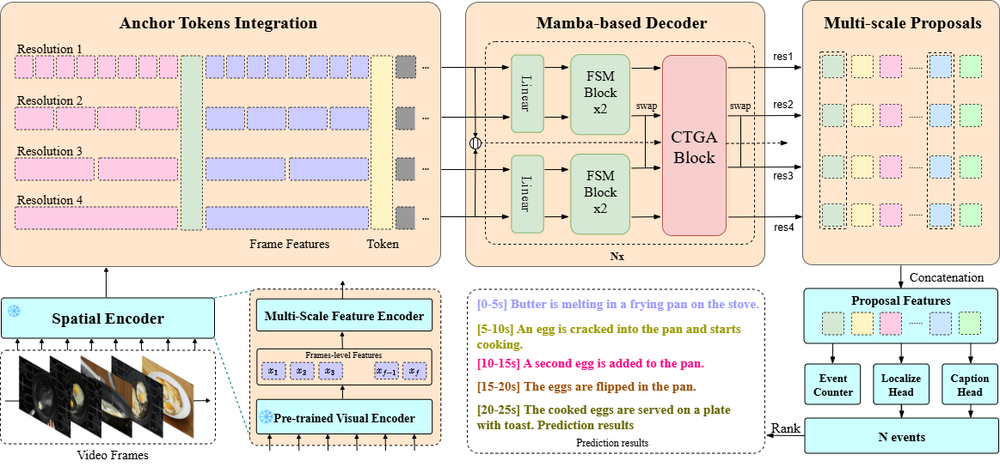

# AMBER: Anchor-based Mamba-driven Dense Video Captioning

---

# 1. Preparation
```bash
# clone Amber repository
git clone https://github.com/rebu1412/AMBER-DVC.git
cd AMBER-DVC

# Set-up Enviroment (DOCKER, NVIDIA CONTAINER TOOLKIT, IMAGE)
# https://hub.docker.com/r/bombom2108/videomamba
make setup VERSION=v5
docker --version
nvidia-ctk --version
docker images
```

## a) Install Dependencies
```bash
# Install mamba_ssm and causal-conv1d inside docker container
make run
pip install -e amber/ops/
pip install -e causal-conv1d/
pip install -e mamba/
```

## b) Check Environment
```bash
# Inside docker container
python
from  .modules.mamba_simple import Mamba
from mamba_ssm.modules.mamba_new import Mamba
from baseline.densevid_eval3.SODA.soda import SODA
# pip install pycocoevalcap 
```

# 2. Training
## a) Download YouCook2 Features
```bash
cd baseline/data/yc2/features/resnet_bn
bash download_yc2_tsn_features.sh
cd ../../..
```
## b) Training 
```bash
# training Amber-LSTM 1 epoch with learnt proposals
python train.py --cfg_path cfgs/yc2_tsn_amber.yml
                --disable_cudnn 1
                --save_dir ./save/
                --epoch 1

# Debug Mode
python train.py --cfg_path cfgs/yc2_tsn_amber.yml
                --disable_cudnn 1
                --save_dir ./save/
                --epoch 1
                --debug
```


# 3. Performance

### Dense video captioning on YouCook2

|  Method | Features | Precision | Recall | B-4 | M | C | SODA |
|  ----  |  ----    |   ----  |  ----  |    ----  |   ----  |  ----  |  ----  |
| Vid2Seq   | CLIP  |  27.80  |  27.90  | -  |  9.30  |  47.10  | 7.90  |
| E2ESG   | C3D  |  20.60  |  20.70  | -  |  -  |  -  | -  |
| CM2   | CLIP  |  33.38  |  24.76  | -  |  -  |  -  | -  |
| MT   | TSN  | -  | - |  1.15 | 5.00 | 9.30 |  -  |
| PDVC  | TSN  | 32.37  | 22.89  | 0.80 | 4.75| 22.71 | 4.42 |
| AMBER(our)  | TSN  | 30.38  | 24.63  | 0.2 | 3.18| 14.5 | 4.11 |

**Notes**  
- `B-4`: BLEU-4  
- `M`: METEOR  
- `R`: ROUGE-L  
- `C`: CIDEr  

---

## Acknowledgement

This codebase is based on [PDVC](https://github.com/ttengwang/PDVC/tree/main) and [video-mamba-suite](https://github.com/OpenGVLab/video-mamba-suite).  
We thank the authors for their contributions.
